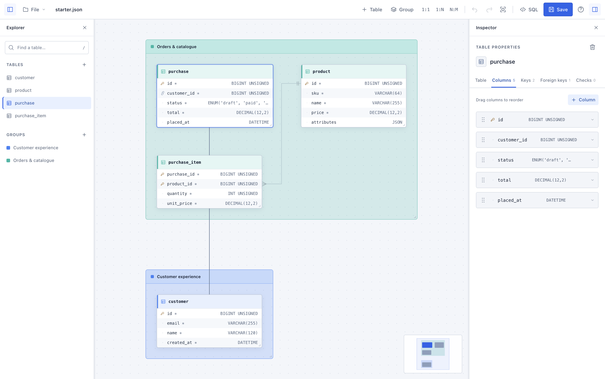
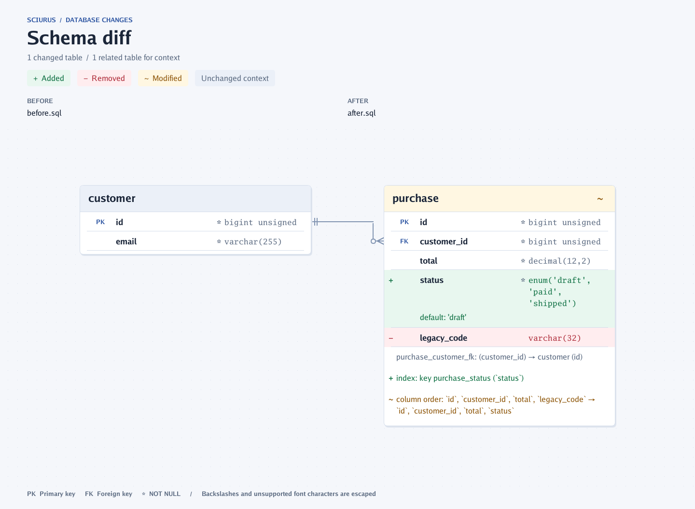

# Sciurus


**A visual MySQL schema, built for Git and AI agents.**

Sciurus is a local schema editor and a replacement for the **ER diagramming part
of MySQL Workbench**. Explore tables and relationships, design changes visually,
and keep the schema and diagram together in one readable JSON file.



## Why Sciurus?

- **Understand the whole schema.** Follow relationships, organise tables into
  coloured groups, and keep a useful visual map alongside your application.
- **Review and merge changes in Git.** The model is plain JSON rather than a
  Workbench `.mwb` archive. Read changes in a pull request and resolve conflicts
  with your normal text tools. Stable IDs keep references intact through renames.
- **Work with AI agents.** An agent can read and edit the same file you use in the
  editor: add tables, update relationships, or rearrange a diagram, then validate
  its changes from the command line.
- **Separate schema changes from presentation.** Schema diffs ignore layout, and
  moving tables never changes generated SQL. Review what the database needs,
  independently of how you arrange the diagram.

Everything runs locally. The executable works offline, without an account or a
running database.

## Get started

Download the archive for your platform from the
[latest GitHub release](https://github.com/mhemmings/sciurus/releases/latest),
extract it, and put `sciurus` (`sciurus.exe` on Windows) on your `PATH`.
Releases support Linux and macOS on amd64/arm64, and Windows on amd64.
Choose arm64 for Apple Silicon, or amd64 for an Intel Mac.

Or install directly with **Go 1.26.11 or later**, without cloning the repository:

```sh
go install github.com/mhemmings/sciurus/cmd/sciurus@latest
```

Make sure Go's install directory is on your `PATH`: `GOBIN` if set, otherwise
`$(go env GOPATH)/bin`.

**Both installation methods include the complete web editor and examples in one
executable.** The prebuilt frontend is embedded by Go, including with `go install`;
Node.js, Yarn and a separate frontend build are unnecessary. Running the installed
executable needs neither Go nor Node.js.

Start the editor:

```sh
sciurus diagram.er.json
```

Open the printed URL, normally [localhost:7480](http://127.0.0.1:7480).
An existing model opens immediately; a new file is created on your first save.
Its parent directory must already exist. Stop the application with Ctrl+C.

To explore first, run `sciurus` without a model and choose **File →
Examples**. Try the four-table [Commerce](examples/starter.json) model or the
28-table [Project Management](examples/project-management.er.json) model.
You can copy the installed executable anywhere.

## Find your way around

| Area | Use it to… |
| --- | --- |
| **Explorer · left** | Search tables, jump to a table or group, and highlight connected relationships by hovering. |
| **Canvas · centre** | Place, move and resize tables and groups; inspect joins and adjust their routes. |
| **Inspector · right** | Edit the selected table's columns, keys, foreign keys and CHECK constraints, or change group and model settings. |
| **Toolbar** | Add objects and relationships, undo/redo, fit the diagram, preview SQL and save. |

Choose **Table** or **Group**, then click the canvas to place it. Double-click a
column to edit it; drag its handle in the inspector to reorder it. Drag table
headers to arrange the diagram. Moving a group carries its tables with it.

For **1:1** or **1:N**, click the referenced table first and the table receiving
the foreign key second. **1:1** adds a unique relationship; **1:N** adds a foreign
key and supporting index. For **N:M**, click the two tables to connect; Sciurus
creates a junction table referencing both. Referenced tables need a primary or
unique key. Select a join and drag a segment to reroute it.

Use **Space + drag** to pan, **Ctrl/Cmd + scroll** to zoom, and **F** to fit the
diagram. **Ctrl/Cmd + S**, **O** and **Z** save, open and undo. The **?** button
lists all shortcuts. Both side panels can be resized or closed.

**Save your work explicitly.** When started with a model filename, Save writes
back to that file and detects conflicting external edits. Browser-opened models
save to the selected file where supported, or download as JSON. Use **Save as…**
for a separate copy. Save before refreshing or stopping the app; unsaved edits
are not recovered.

## Command-line workflows

The following commands use the installed `sciurus` executable. Only `serve`
opens the editor. `import`, `generate` and `diff` write to the terminal unless
you supply `--output FILE`. You can redirect stdout with `>` or pipe it to another
command; `--output` provides atomic writes and rejects input/output collisions.
Pass input filenames positionally, with options before the filenames.

### Edit a model — `serve`

Open a model for visual editing, with Save bound to its file:

```sh
sciurus serve diagram.er.json
```

`serve` is optional: `sciurus diagram.er.json` does the same thing.
Use `--addr 127.0.0.1:0` to choose an available port. The editor is accessible
only from your own computer.

### Bring in an existing schema — `import`

Import a MySQL Workbench model, including its schema and diagram:

```sh
sciurus import --name "My application" --output diagram.er.json diagram.mwb
sciurus diagram.er.json
```

You can also import schema-only `CREATE TABLE` SQL:

```sh
sciurus import --name "My application" --output diagram.er.json schema.sql
```

Use `.mwb` for Workbench or `.sql` for SQL; extensions are case-insensitive.
Workbench imports support one MySQL schema and at most one diagram.
Without a diagram, tables receive an initial grid layout. Model-only and
commented-out objects are excluded from the physical schema.

SQL imports start with a simple layout that you can arrange in the editor.
To use SQL definitions with an existing Workbench diagram's layout:

```sh
sciurus import --workbench diagram.mwb --output diagram.er.json schema.sql
```

In this form, SQL supplies the schema and the archive supplies positions, groups
and view settings. The layout archive must contain exactly one diagram.

### Export reproducible SQL — `generate`

Create SQL from your model for review, source control or use with other tools:

```sh
sciurus generate --no-timestamp --output schema.sql diagram.er.json
```

`--no-timestamp` omits the generated-at comment, making repeated exports identical
for the same schema and Sciurus version. Diagram layout never affects the SQL.
Generated SQL creates tables in an **empty, already-created database**. Sciurus
exports SQL; it does not execute it or produce migrations for an existing database.

### Check manual or agent edits — `validate`

Check the model's structure, SQL syntax and references before committing or
opening an externally edited file:

```sh
sciurus validate diagram.er.json
```

Invalid models return an error and a nonzero exit status. Validation runs offline;
MySQL remains the authority for server-specific restrictions.

### Review schema changes — `diff`

Compare two snapshots, using model JSON or supported SQL in either position:

```sh
sciurus diff before.er.json after.sql
```

Import Workbench `.mwb` files into ER JSON before comparing them.

The report covers database changes, including columns, defaults, keys and
constraints. It ignores positions, colours and other diagram metadata. Renames
appear as removals and additions.

Both inputs pass through Sciurus's shared schema model, then the **Vitess SQL
parser** and Sciurus's normalization rules produce comparable table definitions.
The comparison runs offline. Tests check schema equivalence with **Vitess
schemadiff** and independently with **MySQL**. See
[how diff works](docs/research.md#schema-diff) for normalization rules and limitations.

For a visual review or pull request attachment, export a PNG:

```sh
sciurus diff --format png --output schema-diff.png before.er.json after.er.json
```



Additions are green, removals red and modifications amber. Related unchanged
tables provide context. For very large changes, use the text report.

To check that a model and SQL file agree in CI:

```sh
sciurus diff --exit-code diagram.er.json schema.sql
```

With `--exit-code`, **0** means equal, **1** means different and **2** means an
error. Without it, successful comparisons return 0 even when changes exist.

### Identify your version or find help

```sh
sciurus version
sciurus --help
```

`version` prints the installed version; `--help` lists commands and their options.

## GitHub Actions

Validate models, compare schemas and check model/SQL consistency from another
repository using `mhemmings/sciurus@v0` after the first release.
See the [GitHub Action guide](docs/github-action.md) for workflows, visual reports
and available inputs.

## Working with Git and agents

Commit the `.er.json` file alongside your code. Edit it visually or ask your
coding agent to work directly with its [documented format](docs/format.md) and
[JSON Schema](model.schema.json). For example:

> Add a nullable `archived_at` DATETIME column to `purchase`. Preserve existing
> IDs and diagram layout. Validate the model and show the schema diff.

For reusable agent instructions, copy the [Sciurus skill](skills/sciurus/SKILL.md)
into your agent's skill directory in another repository.

Preserve IDs when renaming objects, and update dependent constraints and SQL
expressions when changing columns. After an agent edit or a merge conflict,
resolve the JSON, run `validate`, and review the schema with `diff`. Text conflicts
are editable with ordinary merge tools; validation checks the resulting model.

## MySQL support

Sciurus supports MySQL/InnoDB tables, including composite and cyclic foreign keys,
generated columns, CHECK constraints, and ordinary, unique, full-text and spatial
indexes. Its integration tests target MySQL 8.4.

Views, routines, triggers, events, partitions, cross-schema references and
functional indexes are outside its scope. SQL imports expect supported
`CREATE TABLE` definitions, without data, `CREATE DATABASE`, `USE`, `ALTER` or
conditional SQL comments. Full database dumps and migration scripts are not
supported imports. Unsupported constructs fail explicitly.

## Development

From a checkout, install with **Go 1.26.11+**:

```sh
go install ./cmd/sciurus
```

Frontend development also needs **Node.js 24+** and **Yarn Classic 1.22**:

```sh
make frontend   # Install frontend dependencies and build the editor.
make build      # Build a local executable at bin/sciurus.
make dev        # Start the local API and frontend development servers.
make test       # Run Go and frontend unit tests.
```

See the [development guide](docs/development.md) for the full setup, hot reload,
builds and repository layout, and the [testing guide](docs/testing.md) for browser
and database tests. Version tags publish tested binaries and generated notes;
see [CI and releases](docs/releases.md).

[Model format](docs/format.md) · [Design decisions](docs/research.md) ·
[MIT license](LICENSE)
